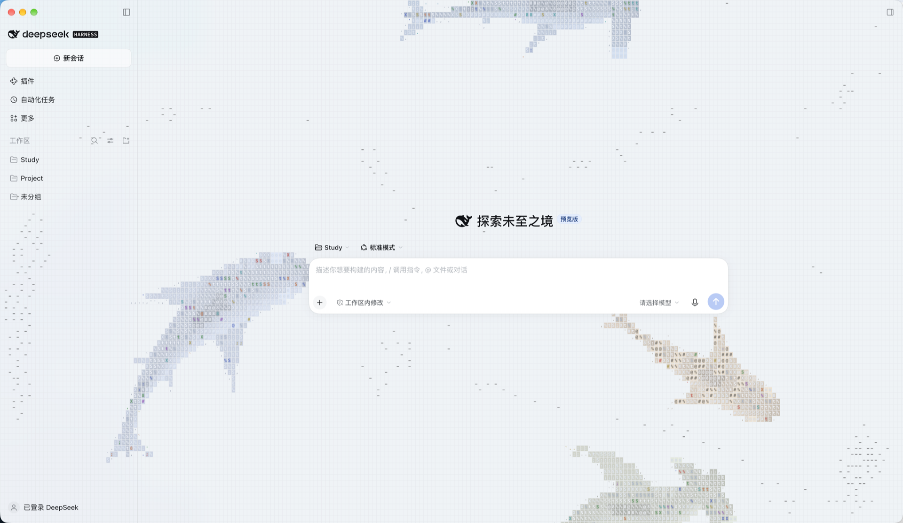
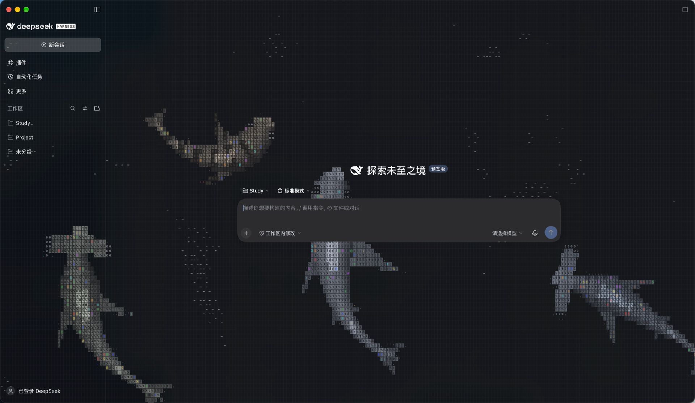
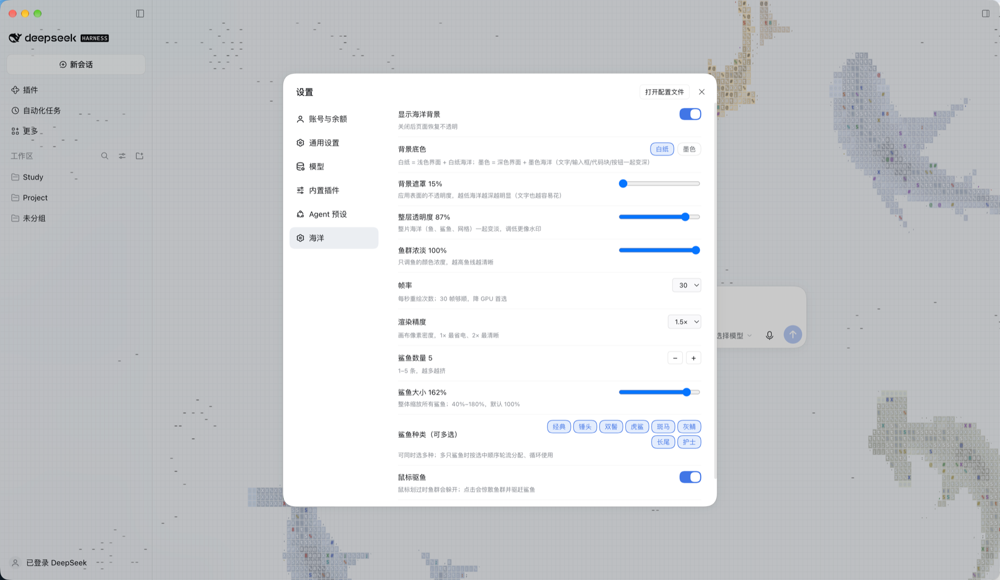

# dsh-wallpaper-sharks

**把 DeepSeek Harness 变成一片会呼吸的海洋。**

[](LICENSE)
[](https://github.com/ai-pm-lab/dsh-wallpaper-sharks)
[](https://github.com/ai-pm-lab/dsh-wallpaper-sharks/stargazers)



---

## 首先，谢谢 @stackedlol

这个插件的**全部生命力**来自 [@stackedlol](https://github.com/stackedlol) 的
[**ascii-sharks**](https://github.com/stackedlol/ascii-sharks)（MIT）：

- 鱼群的 boids 集群、鲨鱼的脊柱游动、ASCII 网格的明暗层次，都是他的作品；
- 本项目只做了一件事：把它从网页里的 hero 小区域，搬进 DSH 的全屏壁纸层，
  再补上主题、设置和性能开关。

**如果你喜欢这个效果，请先去给上游点一个 star。** 这里只是站在他的肩膀上。

> 双墨（白纸 / 墨色）的配色思路参考了 [OGHong/dsh-ascii-sharks](https://github.com/OGHong/dsh-ascii-sharks)，一并致谢。

---

## 截图

| 白纸底 | 墨色底 |
|---|---|
|  |  |

| 设置面板 | 多选鲨鱼 |
|---|---|
|  |  |

> 截图清单和命名规则见 [docs/screenshots/README.md](docs/screenshots/README.md)。

---

## 它是什么

一个 **DSH 客户端 UI 插件**：在 DeepSeek Harness 的窗口最底层铺一张全屏 canvas，
让 ascii-sharks 的鱼群和鲨鱼在**整个界面后面**游动；应用自己的表面变成半透明，
海洋像桌面壁纸一样透出来。

- 不影响交互：canvas 是 `pointer-events:none`、`z-index:-1`；
- 不遮挡文字：所有表面统一走一层可调的遮罩，侧边栏和对话框浓度一致；
- 不挑主题：白纸（浅色）和墨色（深色）两套完整配色。

---

## 特性

- 🌊 **全屏壁纸层**：固定 canvas，随窗口 resize，不挡点击
- 🖋 **双墨主题**：白纸 / 墨色；切墨色会**同时切换整个 DSH 深色主题**（文字、输入框、代码块、按钮、图标、边框一起变）
- 🦈 **8 种鲨鱼**：经典、锤头、双髻、虎鲨、斑马、灰鲭、长尾、护士
- 🎛 **11 项可调**：底色、遮罩、透明度、浓淡、帧率、精度、数量、大小、种类（多选）、鼠标、开关
- 🖱 **互动**：鼠标划过鱼群躲避；**点击会惊散鱼群并驱赶鲨鱼**（受惊 1.8s，加速逃离）
- 💾 **本地持久化**：配置存在 `localStorage`，重开还在
- ⚡ **性能可控**：默认 30fps + DPR 1.5，可降到 15fps / 1×；离屏、切标签页自动暂停

---

## 快速开始

```bash
cd ~/.dsh/profiles/desktop
pnpm add github:ai-pm-lab/dsh-wallpaper-sharks
```

然后在 `~/.dsh/profiles/desktop/cordis.patch.yml` 里追加：

```yaml
- insert:
    - id: wallpaper-sharks
      name: "dsh-wallpaper-sharks"
```

**完全退出并重新打开 DeepSeek Harness**，然后：

> 设置 → **海洋** → 就能看到全部开关。

其他安装方式（本地 link / npm / 按路径插入）见文末。

---

## 设置项（设置 → 海洋）

| 界面名称 | 字段 | 说明 |
|---|---|---|
| 显示海洋背景 | `enabled` | 关闭后页面恢复不透明 |
| 背景底色 | `base` | **白纸**（浅色界面 + 白纸海洋）/ **墨色**（深色界面 + 墨色海洋） |
| 背景遮罩 | `veil` | 整个界面统一的遮罩，15%–80%，越低海洋越明显 |
| 整层透明度 | `opacity` | 整片海洋一起变淡，越低越像水印 |
| 鱼群浓淡 | `strength` | 只调鱼的墨色浓度，越高鱼线越清晰 |
| 帧率 | `fps` | 15 / 30 / 60，降 GPU 首选 |
| 渲染精度 | `dpr` | 1× / 1.5× / 2×，画布像素密度 |
| 鲨鱼数量 | `count` | 1–5 条 |
| 鲨鱼大小 | `sharkScale` | 40%–180%，整体缩放，原地生效 |
| 鲨鱼种类 | `species` | **多选**；多只鲨鱼按选中顺序轮流分配 |
| 鼠标驱鱼 | `interactive` | 划过躲避 + 点击驱赶 |
| 恢复默认 | — | 二次确认后重置本页所有参数 |

---

## 性能

全屏 `cw=8` 约 2 万格，原版是给 hero 小区域设计的，所以默认就压了一档：

- **帧率默认 30fps**：rAF 仍跑 60，跳帧渲染；
- **DPR 默认 1.5**：Retina 上比 2× 少约 44% 像素；
- 页面隐藏 / 离屏自动停；`prefers-reduced-motion` 只画一帧。

觉得卡或 GPU 高：**帧率 → 15**、**渲染精度 → 1×**。

---

## 它是怎么工作的

```
┌─────────────────────────────┐
│ #root                        │ ← 单层 veil（--dsh-wallpaper-veil）
│  ├─ 侧边栏（透明）            │
│  ├─ 对话框（透明）            │
│  └─ …                        │
└─────────────────────────────┘
        ▲ 半透明
┌─────────────────────────────┐
│ canvas（z-index:-1）         │ ← ascii-sharks 引擎
└─────────────────────────────┘
```

- 背景层挂在 `body` 下、`z-index:-1`；
- `#root` 画一层 veil，布局各列全部透明，**侧边栏和对话框浓度一致**；
- 墨色时通过 DSH 主题服务切到深色 token，而不是自己硬改颜色；
- 引擎是 vendored 的 ascii-sharks（MIT），在 `vendor/` 里做了主题化改造，详见 [NOTICE.md](NOTICE.md)。

---

## 目录结构

```
dsh-wallpaper-sharks/
├─ lib/
│  ├─ index.js          # 宿主半（no-op）
│  └─ client.js         # 浏览器半（构建产物，react 外置）
├─ src/
│  ├─ client.tsx        # 背景挂载 + 设置面板
│  └─ store.ts          # localStorage 配置
├─ vendor/              # ascii-sharks 引擎（MIT，见 NOTICE.md）
├─ scripts/build.mjs    # esbuild 打包成 DSH 插件信封
├─ docs/screenshots/    # 截图（命名规则见其中 README）
└─ LICENSE / NOTICE.md / CHANGELOG.md
```

## 开发

```bash
npm run build
# 或：npm_config_cache=/tmp/npmcache-build node scripts/build.mjs
```

> 构建用 `npx esbuild@0.24.0`。已构建的 `lib/client.js` 随仓库提供，使用者无需构建。

## 其他安装方式

**本地 link（开发用）**

```bash
cd ~/.dsh/profiles/desktop
pnpm add link:"/path/to/dsh-wallpaper-sharks"
```

**npm（发布后）**

```bash
pnpm add dsh-wallpaper-sharks
```

**按路径插入（不推荐，插件列表会显示 `file:///…`）**

```yaml
- insert:
    - id: wallpaper-sharks
      name: "/path/to/dsh-wallpaper-sharks/lib/index.js"
```

## 卸载

- 包安装：`pnpm remove dsh-wallpaper-sharks`，再删 patch 里的 insert；
- 路径插入：删 patch 里的 insert。

重启生效。

---

## 致谢 & 许可

- **引擎**：[stackedlol/ascii-sharks](https://github.com/stackedlol/ascii-sharks) — MIT，作者 [@stackedlol](https://github.com/stackedlol)
- **双墨配色参考**：[OGHong/dsh-ascii-sharks](https://github.com/OGHong/dsh-ascii-sharks)
- **本项目**：MIT © ai-pm-lab

如果这个壁纸让你的 Harness 好看了一点，去给上游点个 star 吧 ⭐
